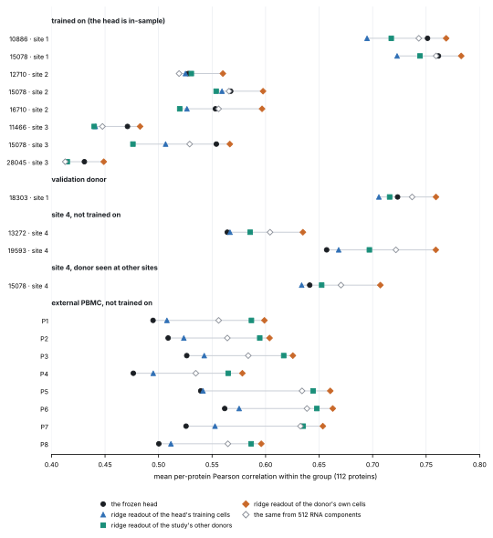

# Generalization to unseen donors: where is the signal the head does not deliver? — 12 November 2026

Exploratory. The design and the readings are in [`DESIGN.md`](DESIGN.md), committed with [`scripts/gate0.py`](scripts/gate0.py) before the script was run on data. No model was trained. Every donor here has been looked at before; nothing is final data.

The first run was killed for lack of memory during the fits, before any result was written. The script was changed to hold less in memory (fits, folds and seeds unchanged; identical output on synthetic data) and run again; the results below are from that run.

Each row is one donor (bone marrow: one donor at one site). The score is the repository's: the Pearson correlation between predicted and measured protein within the group, averaged over the 112 proteins measured in both studies. Readouts are ridge regressions on TEDDY's pooled state, scored on cells they were not fitted on.

## Outcome by the readings written in advance

A term is resolved in a donor if its interval lies above 0.02, absent if it lies below. A reading is stated for a study only if it holds in every donor of that study the head was not trained on.

| reading | term | bone marrow (4 groups the head was not trained on) | external PBMC (8 donors) |
|---|---|---|---|
| the head leaves transferable signal undelivered | readout of the head's training cells − head | does not hold (absent in every donor): resolved in 0 of 4, absent in 4, range −0.017 to 0.011 | not stated: resolved in 1 of 8, absent in 6, range 0.002 to 0.027 |
| more donors of the same kind are needed | other donors of the study − the head's training cells | not stated: resolved in 1 of 4, absent in 1, range 0.010 to 0.029 | **holds**: resolved in 8 of 8, absent in 0, range 0.070 to 0.103 |
| part is specific to the donor | own cells − other donors of the study | **holds**: resolved in 4 of 4, absent in 0, range 0.043 to 0.062 | not stated: resolved in 0 of 8, absent in 7, range 0.009 to 0.018 |
| part is lost before the head | RNA components − state, own cells | does not hold (absent in every donor): resolved in 0 of 4, absent in 4, range −0.037 to −0.022 | does not hold (absent in every donor): resolved in 0 of 8, absent in 8, range −0.044 to −0.021 |

## What the numbers show

- **The head already delivers most of what is readable.** On the 12 groups it was not trained on, its score is 80% to 95% of the score of a readout fitted on the donor's own cells (bone marrow 87% to 95%, external 80% to 85%). What separates the groups is mostly that ceiling: 0.45 to 0.78 over the 20 groups, by site. That explains the table that opened the design.
- **No sign that the head leaves transferable signal undelivered.** A readout fitted on the head's own training cells differs from the head by −0.017 to 0.027: absent in 10 of 12, unresolved in 1, resolved in 1. On the same cells a kernel ridge does not beat the head by more than 0.03.
- **External donors: the study is missing, not the donor.** With the other seven donors of the study in the fit the score rises by 0.070 to 0.103 (resolved in 8 of 8), and 0.009 to 0.018 then remains to the donor's own cells. Donors of one study teach each other almost everything. Tissue, laboratory and antibody panel all differ between the two studies, and these data cannot separate them.
- **Bone marrow: the site and the sample.** Leaving a group's site out of the fit costs 0.00 to 0.04. The donor's own cells add 0.043 to 0.062 over the other donors (resolved in 4 of 4). A bone-marrow group is one donor at one site, one sample. For donor 15078 at site 4 the three can be told apart: adding that donor's cells from the other sites adds 0.010, adding the other donors of site 4 adds 0.029, and the donor's own site-4 cells add 0.055 more. That points to the sample, not the person. The external donors share runs, and there the term is absent.
- **Nothing is lost before the head, against 512 RNA components.** Fitted on a donor's own cells, the state scores higher than the RNA components in 20 of 20 groups, by 0.021 to 0.044. In transfer from the head's training cells the two are within 0.013 of each other.
- **A donor's shift in protein level (external donors).** The head leaves 64% to 86% of it unexplained. The state, read by a readout of the other donors, leaves 8% to 29% (below the 0.10 margin in 1 of 8); a readout of the head's training cells leaves 83% to 106%. The shift is in the state and the head does not carry it, the pattern of the PD-L1 audits, and here it takes data of the same study to read it. In bone marrow the state leaves 16% to 90% unexplained: part of a sample's shift is not in the RNA.

## What follows for a loop aimed at donors and diseases

- The unit to hold out is the study or the batch. Holding out donors inside a study the head has seen would test little.
- The change to test is coverage: cells of another study in the head's training. Its control is the same number of cells from studies already covered, so that coverage is separated from amount.
- The size to expect on a new study of a kind already covered is the same-study term above, 0.07 to 0.10 here, measured with a ridge readout. Whether the head gains as much is not shown; that needs a training run.
- Repairing the head at a located step, as in the knockout loop, is not what these numbers call for.
- Disease is untested. Every donor here is healthy.

## Donors the head was not trained on

| donor | cells | the head | readout of the head's training cells | readout of the study's other donors | readout of the donor's own cells | RNA components, own cells |
|---|---|---|---|---|---|---|
| bone marrow, donor 13272, site 4 (donor and site unseen) | 7,365 | 0.564 | 0.567 | 0.586 | 0.635 | 0.604 |
| bone marrow, donor 15078, site 4 (site unseen; the donor is in training at other sites) | 5,456 | 0.641 | 0.634 | 0.652 | 0.707 | 0.670 |
| bone marrow, donor 18303, site 1 (donor unseen, site seen; used to choose the checkpoint) | 6,106 | 0.723 | 0.706 | 0.716 | 0.759 | 0.737 |
| bone marrow, donor 19593, site 4 (donor and site unseen) | 3,929 | 0.657 | 0.668 | 0.697 | 0.759 | 0.722 |
| PBMC, donor P1 (another study and tissue) | 5,000 | 0.495 | 0.508 | 0.587 | 0.599 | 0.556 |
| PBMC, donor P2 (another study and tissue) | 5,000 | 0.509 | 0.524 | 0.595 | 0.604 | 0.564 |
| PBMC, donor P3 (another study and tissue) | 5,000 | 0.526 | 0.543 | 0.617 | 0.625 | 0.584 |
| PBMC, donor P4 (another study and tissue) | 5,000 | 0.476 | 0.495 | 0.565 | 0.578 | 0.535 |
| PBMC, donor P5 (another study and tissue) | 5,000 | 0.539 | 0.542 | 0.644 | 0.660 | 0.634 |
| PBMC, donor P6 (another study and tissue) | 5,000 | 0.562 | 0.575 | 0.648 | 0.663 | 0.639 |
| PBMC, donor P7 (another study and tissue) | 5,000 | 0.526 | 0.553 | 0.635 | 0.654 | 0.633 |
| PBMC, donor P8 (another study and tissue) | 5,000 | 0.500 | 0.512 | 0.587 | 0.596 | 0.565 |

The differences, with intervals from 300 resamples of the donor's cells:

| donor | readout − head | other donors of the study − head's training cells | own cells − other donors | RNA components − state (own cells) | cost of an unseen site |
|---|---|---|---|---|---|
| bone marrow, donor 13272, site 4 | 0.003 [0.001, 0.004] absent | 0.019 [0.018, 0.020] unresolved | 0.049 [0.048, 0.051] resolved | −0.031 [−0.032, −0.029] absent | 0.000 [0.000, 0.000] absent |
| bone marrow, donor 15078, site 4 | −0.008 [−0.010, −0.006] absent | 0.019 [0.017, 0.020] unresolved | 0.055 [0.053, 0.057] resolved | −0.037 [−0.039, −0.035] absent | 0.010 [0.009, 0.011] absent |
| bone marrow, donor 18303, site 1 | −0.017 [−0.019, −0.016] absent | 0.010 [0.009, 0.011] absent | 0.043 [0.042, 0.045] resolved | −0.022 [−0.024, −0.021] absent | 0.040 [0.039, 0.042] resolved |
| bone marrow, donor 19593, site 4 | 0.011 [0.009, 0.014] absent | 0.029 [0.027, 0.030] resolved | 0.062 [0.059, 0.064] resolved | −0.037 [−0.039, −0.035] absent | 0.000 [0.000, 0.000] absent |
| PBMC, donor P1 | 0.013 [0.011, 0.015] absent | 0.079 [0.074, 0.083] resolved | 0.012 [0.010, 0.014] absent | −0.043 [−0.045, −0.040] absent | 0.000 [0.000, 0.000] absent |
| PBMC, donor P2 | 0.015 [0.012, 0.017] absent | 0.071 [0.067, 0.075] resolved | 0.009 [0.008, 0.011] absent | −0.039 [−0.042, −0.038] absent | 0.000 [0.000, 0.000] absent |
| PBMC, donor P3 | 0.016 [0.014, 0.018] absent | 0.074 [0.070, 0.078] resolved | 0.009 [0.007, 0.010] absent | −0.042 [−0.044, −0.040] absent | 0.000 [0.000, 0.000] absent |
| PBMC, donor P4 | 0.019 [0.016, 0.021] unresolved | 0.070 [0.066, 0.075] resolved | 0.013 [0.011, 0.015] absent | −0.044 [−0.046, −0.041] absent | 0.000 [0.000, 0.000] absent |
| PBMC, donor P5 | 0.002 [0.000, 0.004] absent | 0.103 [0.099, 0.106] resolved | 0.016 [0.014, 0.018] absent | −0.026 [−0.028, −0.025] absent | 0.000 [0.000, 0.000] absent |
| PBMC, donor P6 | 0.014 [0.011, 0.016] absent | 0.073 [0.070, 0.075] resolved | 0.015 [0.013, 0.017] absent | −0.024 [−0.026, −0.022] absent | 0.000 [0.000, 0.000] absent |
| PBMC, donor P7 | 0.027 [0.025, 0.029] resolved | 0.082 [0.079, 0.085] resolved | 0.018 [0.017, 0.020] unresolved | −0.021 [−0.023, −0.019] absent | 0.000 [0.000, 0.000] absent |
| PBMC, donor P8 | 0.011 [0.009, 0.014] absent | 0.075 [0.072, 0.078] resolved | 0.009 [0.008, 0.011] absent | −0.031 [−0.033, −0.029] absent | 0.000 [0.000, 0.000] absent |

## Groups the head was trained on, for reference

The head is in-sample here, so its score is not comparable with the readouts, which never contain the donor they are scored on. "Without the site" is the readout of the head's training cells fitted without the group's donor and without its site.

| group | cells | the head (in-sample) | readout, donor left out | readout, donor and site left out | readout of the study's other donors | own cells |
|---|---|---|---|---|---|---|
| bone marrow, donor 10886, site 1 | 4,978 | 0.751 | 0.695 | 0.664 | 0.717 | 0.769 |
| bone marrow, donor 11466, site 3 | 11,473 | 0.471 | 0.441 | 0.419 | 0.440 | 0.483 |
| bone marrow, donor 12710, site 2 | 5,584 | 0.528 | 0.525 | 0.524 | 0.531 | 0.560 |
| bone marrow, donor 15078, site 1 | 5,227 | 0.761 | 0.723 | 0.697 | 0.744 | 0.783 |
| bone marrow, donor 15078, site 2 | 10,465 | 0.567 | 0.559 | 0.532 | 0.554 | 0.598 |
| bone marrow, donor 15078, site 3 | 9,521 | 0.554 | 0.507 | 0.483 | 0.476 | 0.567 |
| bone marrow, donor 16710, site 2 | 9,122 | 0.553 | 0.527 | 0.505 | 0.520 | 0.597 |
| bone marrow, donor 28045, site 3 | 11,035 | 0.431 | 0.414 | 0.403 | 0.415 | 0.449 |

## The donor's shift

For each donor, the shift of every protein's mean against the other donors of the same study, in units of their spread, and the share of it that a prediction leaves unexplained (*u*, over proteins). A shift is carried if the upper bound of *u* is below 0.10. A donor's shift mixes biology with staining and batch.

| donor | size of the shift (RMS, in SD) | the head | state, readout of the study's other donors | RNA components, readout of the study's other donors | state, readout of the head's training cells |
|---|---|---|---|---|---|
| bone marrow, donor 10886, site 1 (trained on) | 0.55 | 0.47 [0.46, 0.48] not carried | 0.17 [0.17, 0.18] not carried | 0.16 [0.16, 0.17] not carried | 0.29 [0.28, 0.30] not carried |
| bone marrow, donor 11466, site 3 (trained on) | 0.39 | 0.45 [0.43, 0.46] not carried | 0.46 [0.45, 0.47] not carried | 0.61 [0.60, 0.62] not carried | 0.99 [0.97, 1.01] not carried |
| bone marrow, donor 12710, site 2 (trained on) | 0.23 | 0.35 [0.34, 0.37] not carried | 0.77 [0.74, 0.81] not carried | 0.84 [0.80, 0.87] not carried | 0.97 [0.92, 1.01] not carried |
| bone marrow, donor 13272, site 4 | 0.48 | 0.62 [0.61, 0.63] not carried | 0.47 [0.46, 0.48] not carried | 0.45 [0.45, 0.46] not carried | 0.67 [0.66, 0.69] not carried |
| bone marrow, donor 15078, site 1 (trained on) | 0.44 | 0.56 [0.54, 0.57] not carried | 0.16 [0.16, 0.17] not carried | 0.16 [0.15, 0.16] not carried | 0.40 [0.39, 0.42] not carried |
| bone marrow, donor 15078, site 2 (trained on) | 0.36 | 0.63 [0.61, 0.64] not carried | 0.68 [0.68, 0.69] not carried | 0.77 [0.76, 0.77] not carried | 0.88 [0.88, 0.89] not carried |
| bone marrow, donor 15078, site 3 (trained on) | 0.56 | 0.09 [0.08, 0.09] carried | 1.00 [0.99, 1.02] not carried | 0.88 [0.87, 0.89] not carried | 0.89 [0.88, 0.90] not carried |
| bone marrow, donor 15078, site 4 | 0.43 | 1.83 [1.79, 1.87] not carried | 0.90 [0.88, 0.92] not carried | 0.95 [0.93, 0.97] not carried | 1.30 [1.28, 1.33] not carried |
| bone marrow, donor 16710, site 2 (trained on) | 0.50 | 0.30 [0.29, 0.31] not carried | 0.57 [0.56, 0.58] not carried | 0.55 [0.55, 0.56] not carried | 0.76 [0.75, 0.76] not carried |
| bone marrow, donor 18303, site 1 | 0.52 | 0.45 [0.44, 0.46] not carried | 0.16 [0.16, 0.17] not carried | 0.29 [0.29, 0.30] not carried | 0.18 [0.17, 0.19] not carried |
| bone marrow, donor 19593, site 4 | 0.55 | 0.87 [0.86, 0.88] not carried | 0.39 [0.38, 0.40] not carried | 0.47 [0.46, 0.48] not carried | 0.54 [0.53, 0.55] not carried |
| bone marrow, donor 28045, site 3 (trained on) | 0.37 | 0.51 [0.50, 0.52] not carried | 0.81 [0.80, 0.83] not carried | 0.86 [0.84, 0.87] not carried | 1.00 [0.98, 1.02] not carried |
| PBMC, donor P1 | 0.24 | 0.83 [0.81, 0.85] not carried | 0.08 [0.08, 0.09] carried | 0.07 [0.06, 0.07] carried | 1.06 [1.03, 1.09] not carried |
| PBMC, donor P2 | 0.28 | 0.64 [0.62, 0.66] not carried | 0.12 [0.12, 0.13] not carried | 0.26 [0.25, 0.28] not carried | 0.86 [0.83, 0.89] not carried |
| PBMC, donor P3 | 0.24 | 0.80 [0.78, 0.82] not carried | 0.21 [0.20, 0.23] not carried | 0.18 [0.17, 0.19] not carried | 1.02 [1.00, 1.05] not carried |
| PBMC, donor P4 | 0.27 | 0.76 [0.74, 0.78] not carried | 0.14 [0.13, 0.15] not carried | 0.11 [0.11, 0.12] not carried | 0.87 [0.84, 0.90] not carried |
| PBMC, donor P5 | 0.28 | 0.73 [0.71, 0.75] not carried | 0.18 [0.17, 0.19] not carried | 0.16 [0.15, 0.17] not carried | 0.83 [0.81, 0.86] not carried |
| PBMC, donor P6 | 0.29 | 0.82 [0.80, 0.84] not carried | 0.27 [0.26, 0.28] not carried | 0.26 [0.25, 0.27] not carried | 0.93 [0.90, 0.95] not carried |
| PBMC, donor P7 | 0.32 | 0.86 [0.84, 0.88] not carried | 0.25 [0.24, 0.27] not carried | 0.22 [0.21, 0.23] not carried | 1.05 [1.01, 1.09] not carried |
| PBMC, donor P8 | 0.25 | 0.73 [0.70, 0.76] not carried | 0.29 [0.28, 0.30] not carried | 0.23 [0.23, 0.24] not carried | 1.00 [0.96, 1.03] not carried |

## Readout classes and penalties

Chosen class by fit (of 20 groups): `RAW_C` ridge 20, with random features 0; `RAW_L` ridge 20, with random features 0; `RAW_S` ridge 20, with random features 0; `RAW_T` ridge 20, with random features 0; `Z_C` ridge 0, with random features 20; `Z_L` ridge 0, with random features 20; `Z_S` ridge 0, with random features 20; `Z_T` ridge 0, with random features 20.

## Public data that could carry a loop aimed at donors and diseases

Public single-cell data with rna and surface protein in the same cells, read for a loop that aims at unseen donors and diseases; assembled 12 nov 2026 from the pages listed under sources; nothing was downloaded. TEDDY's pretraining data: CELLxGENE, downloaded 11 June 2024; 116 million cells after quality control; human and mouse; diseased cells included; datasets used for the paper's downstream tests were removed.

| data | tissue | donors | disease | proteins | overlap with the head's 134 | access | what it could serve | status |
|---|---|---|---|---|---|---|---|---|
| Luecken et al. 2021 (NeurIPS 2021 BMMC CITE-seq) (GSE194122) | bone marrow mononuclear cells | 9 donors at 4 sites | healthy only | 134 | 134 of 134 (the training data) | open | in use: the head's training and test data | checked (the repository's own files) |
| Hao et al. 2021 (PBMC, vaccine trial donors) (GSE164378) | PBMC | 8 | healthy only | 228 | 112 of 134 | open | in use: external evaluation; 40,000 cells embedded | checked (the repository's own files) |
| Stephenson et al. 2021, Nat Med (COVID-19 PBMC, three UK centres) (E-MTAB-10026; EGAS00001005465; h5ad at covid19cellatlas.org) | PBMC | 130 (the HCA page lists 120) | COVID-19 from asymptomatic to critical; healthy; non-COVID severe respiratory illness; healthy volunteers given LPS | 188 to 192 (TotalSeq-C) | not checked; needs the antibody list | processed data open (CC BY 4.0 on the HCA portal) | candidate: the largest open cohort with patients and healthy donors in one study | checked |
| Liu et al. 2021, Cell (COVID-19, longitudinal) (GSE161918) | PBMC | 46 samples; donors not stated on the pages read | COVID-19 and age-matched healthy | 188 to 192 | not checked | open (GEO) | candidate: a second COVID-19 cohort from another lab, same panel family | checked |
| COMBAT consortium 2022, Cell (blood atlas of COVID-19) (Zenodo records 5139561 and 6120249; EGA; HCA project) | PBMC (CITE-seq on 140 samples) | about 140 samples; counts per group not on the pages read | hospitalised and community COVID-19, sepsis, influenza, healthy volunteers aged 55 or over | 192 | not checked | processed data on Zenodo; raw data at EGA | candidate: three diseases and healthy donors in one study, so a disease contrast that is not only COVID-19 | checked |
| NeurIPS 2022 multimodal integration (CD34+ HSPC, CITE-seq) (Kaggle open-problems-multimodal) | mobilized CD34+ cells, 5 time points | 4 | healthy only | 140 | expected high (same panel family as the training data); not checked | open | candidate for donors only: few donors, same lab family as the training data | recalled |
| Zhang et al. 2024, Nat Immunol (bone-marrow progenitor atlas) (not on the pages read) | bone marrow, sorted progenitor fractions | 4 + 4 healthy; 3 AML samples profiled with the 132-antibody panel | healthy; 3 AML | 132 (optimized) of 266 TotalSeq-A | not checked | not checked | candidate for bone marrow: disease samples are too few for a disease claim | checked |
| Terekhova et al. 2023, Immunity (healthy ageing blood atlas) (Synapse syn49637038) | PBMC | 166 (317 samples), 25 to 85 years | healthy only | 20 | at most 20 | controlled (Synapse) | not suitable as it stands: 20 proteins | checked |
| GSE345981 (multiple sclerosis) (GSE345981) | PBMC | 12 patients, 4 healthy | multiple sclerosis; healthy | 42 | at most 42 | open (GEO) | small panel; released after TEDDY's download date, so its RNA is unseen | checked |
| GSE236233 (chronic myeloid leukemia under TKI) (GSE236233) | not stated | not stated | CML | more than 40 |  | open (GEO) | small panel | checked |
| Triana et al. 2021, Nat Immunol (bone marrow, AML) (figshare project 94469) | bone marrow | 6 healthy, 3 to 15 AML | healthy; AML, APL | 97 and 197 (BD AbSeq) |  | open | not usable: the RNA is mostly a targeted panel of 462 genes | checked |
| 10x Genomics, 128k PBMC with TotalSeq-C Universal Cocktail (10x datasets page) | PBMC | 1 | healthy | TotalSeq-C Human Universal Cocktail v1.0 |  | open (CC BY 4.0) | not usable for donors: one donor | checked |

- Disease with many donors and a large panel exists in the open only for blood in infection: three COVID-19 cohorts with about 190 antibodies each, one of them with sepsis and influenza as well.
- No open cohort was found with many cancer or autoimmune patients, whole-transcriptome RNA and a panel above about 50 antibodies. The bone-marrow leukemia sets are either targeted-RNA or have a handful of patients.
- The overlap of the 190-antibody COVID-19 panels with the head's 134 outputs is not known until an antibody list is read; the 228-antibody panel of Hao 2021 overlapped 112.
- Most large cohorts were public before June 2024, so their RNA may have been in TEDDY's pretraining data. Their protein was not.

Sources are listed in [`results/public_data_census.json`](results/public_data_census.json).

## Limits

- Twelve donors the head was not trained on, all healthy, none of them new to this repository. The intervals describe each donor's cells; they say nothing about donors in general and nothing about disease.
- The readouts are ridge regressions, not the head's architecture. Where a readout scores below the head, that does not show that nothing more is available.
- The RNA is represented by 512 principal components. Signal outside them is not counted as readable from the RNA.
- The score ignores level and scale within a group. The donor's shift looks at level, within a study only, and it mixes biology with staining.
- The external study's RNA may have been in TEDDY's pretraining data.
- One head, one training seed.

## Files

- [`DESIGN.md`](DESIGN.md), [`scripts/gate0.py`](scripts/gate0.py), [`scripts/write_readme.py`](scripts/write_readme.py)
- [`results/gate0.json`](results/gate0.json): every score, term and interval; [`results/gate0_per_protein.json`](results/gate0_per_protein.json): the same by protein
- [`results/public_data_census.json`](results/public_data_census.json)
