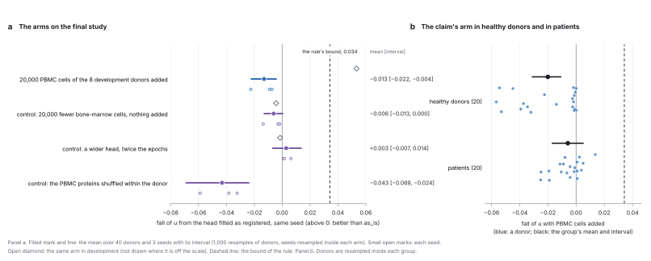
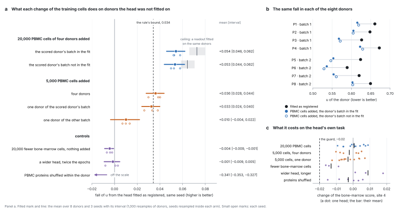

# Round 1: a head for donors it has not seen — development (16 November 2026) and the test (17 November 2026)

**One test, read once; everything else is exploratory.** The design is [`DESIGN.md`](DESIGN.md), frozen before any script of the round existed. The test (gate 5) comes first below; the development it rests on (gates 3, 4 and 6) follows unchanged.

**The test did not bear the round out.** The gain read in development (+0.053) is not there on the study of the test (−0.013 [−0.022, −0.004]). By the rule written first the outcome is *unresolved*, because one of the three heads of the claim is not admitted; the two seeds that can be read are each *refuted*. **The grid read afterwards shows that the bound could not have been met on this study**: a readout fitted on its own donors reads only 0.006 [0.002, 0.011] more than the head, against 0.073 on the development study. On this study the head is not short of coverage.

## The test (gate 5), 17 November 2026

Read once, on a study nobody in this repository had looked at: Stephenson et al. 2021, Nat Med 27:904, COVID-19 PBMC CITE-seq (ArrayExpress E-MTAB-10026; haniffa21.processed.h5ad). 40 donors chosen by the rule of gate 0b (20 healthy, 20 patients), 1,000 cells each, 95 proteins. Every step is recorded in [`GATE5.md`](GATE5.md), each part committed before the step it governs; the declaration ([`results/gate5_declaration.json`](results/gate5_declaration.json)) names every input by hash, and [`scripts/read_final.py`](scripts/read_final.py) refuses any other.

*u* is the share of the variation among a donor's cells that the head's output leaves unexplained: 1 minus the mean over the 95 proteins of r² within the donor. A gain is the fall of *u* from the head fitted as registered (`as_is`) with the same seed, on the same cells. No head was fitted on a cell of this study.

### Outcome

- **The gain of development is not there on this study.** With the PBMC cells of the development study in its training, the head's *u* on the 40 donors goes from 0.808 to 0.821: a gain of −0.013 [−0.022, −0.004], below 0; by seed −0.007, −0.022, −0.009. The bound of the rule is 0.034; in development the same arm gained +0.053 [0.044, 0.062] on donors of the study it was fitted on. The head with PBMC cells is the worse of the two in 31 of the 40 donors. In the head's ordinary score, the mean correlation within a donor: 0.341 against 0.329.
- **`donors_hao_coverage`: unresolved, by the rule written first.** The rule: `coverage` at or above the bound; `function` and `amount` below it (0.034); the outcome over the three seeds together counts only if each seed alone reads the same. Over the three seeds together: not testable (an arm of the rule is not admitted in one seed, below). Each seed alone: refuted, not testable, refuted.
- **`coverage_not_levels`: unresolved, by the rule written first.** The rule: `coverage` at or above the bound; `labels` below it (0.034); the outcome over the three seeds together counts only if each seed alone reads the same. Over the three seeds together: not testable (an arm of the rule is not admitted in one seed, below). Each seed alone: refuted, not testable, refuted.
- **Admission: `s1_coverage_all` is not admitted** (gate 3): its validation score falls at the end of training (last 5 epochs 0.729, the 5 before 0.744; the limit is a fall of 0.005). The fall is in the last epoch alone: 0.664 after 0.746 over the five epochs before it ([`results/gate5_fit_histories.json`](results/gate5_fit_histories.json)). The head that is scored is the checkpoint of epoch 39. The rule of admission is applied as written. The other fourteen heads are admitted. A head that is not admitted was not tested, so the three seeds together are not testable and the round's outcome is not stated as refuted.
- **The guard, stated over every head of the test, does not hold**: on bone marrow, site 4, `s2_labels_all` (a control) scores 0.022 below `as_is` of its seed, against a limit of 0.02. The three `coverage` heads are within it (+0.004, +0.002, −0.014).
- **In the table of outcomes of [`DESIGN.md`](DESIGN.md)** the rule gives the row *unresolved*. The table wrote that row for intervals that do not decide; here the intervals decide in every seed that can be read, and they read the row *own arm below the bound, development had delivered*. The table gives that row the meaning that what was learned belongs to the study. The grid, read after the test, does not support putting it that way: on this study there was next to nothing of that kind to gain (below). The step the table names after *unresolved*, the reserve donors read once, has not been taken: more donors do not change the admission of a head, and opening them is the owner's decision.

### The arms on the final study

| arm | *u* | fall of *u* from `as_is` | by seed | read against 0.034, by seed | forecast | ordinary score |
|---|---|---|---|---|---|---|
| `as_is` | 0.808 | | | | | 0.341 |
| `coverage`: 20,000 PBMC cells of the 8 development donors added | 0.821 | −0.013 [−0.022, −0.004] | −0.007, −0.022, −0.009 | below, below, below | 0.068 to 0.082; from development 0.044 to 0.062 | 0.329 |
| `amount`: 20,000 fewer bone-marrow cells, nothing added | 0.814 | −0.006 [−0.013, 0.000] | −0.003, −0.014, −0.002 | below, below, below | −0.050 to 0.050 | 0.334 |
| `function`: a wider head, twice the epochs | 0.805 | +0.003 [−0.007, 0.014] | +0.001, +0.006, +0.002 | below, below, below | −0.004 to 0.001 | 0.344 |
| `labels`: the PBMC proteins shuffled within the donor | 0.851 | −0.043 [−0.069, −0.024] | −0.032, −0.038, −0.059 | below, below, below | −0.353 to −0.327 | 0.292 |

The head in use has *u* = 0.814 on these cells. Every head leaves about four fifths of the variation unexplained here, against 0.636 for `as_is` on the development study. With 40 donors the intervals over donors are not marked approximate (10 donors or more).

### Healthy donors and patients

| arm | healthy donors | patients | patients minus healthy |
|---|---|---|---|
| `coverage` | −0.020 [−0.031, −0.011] | −0.006 [−0.017, 0.005] | +0.014 [0.001, 0.026] |
| `amount` | −0.007 [−0.013, −0.003] | −0.005 [−0.015, 0.005] | +0.002 [−0.007, 0.011] |
| `function` | −0.002 [−0.009, 0.006] | +0.008 [−0.005, 0.021] | +0.010 [0.003, 0.020] |
| `labels` | −0.055 [−0.089, −0.030] | −0.031 [−0.057, −0.009] | +0.024 [−0.005, 0.050] |

Donors are resampled inside each group. This reading was declared and does not change the outcome. Healthy donors and patients differ in more than the disease (centre, age, time of sampling); the difference is not an effect of the disease alone.

### Without the proteins matched under another name

Of the 95 proteins, 49 carry the same name in the study and in the head's panel; the others were matched as the same target under another name (GATE5.md, part 2). On those 49 alone *u* of `as_is` is 0.766, and the gains are: `coverage` −0.013 [−0.023, −0.002], `amount` −0.007 [−0.015, 0.001], `function` +0.003 [−0.010, 0.017], `labels` −0.049 [−0.080, −0.026]. Declared before the reading; not part of the outcome. The reading is the same without the matched names.

### How the forecasts held

1 of 5 measured gains falls inside its forecast.

| hypothesis | arm | forecast | measured | inside |
|---|---|---|---|---|
| `donors_hao_coverage` | `coverage` | 0.068 to 0.082 | −0.013 | no |
| `donors_hao_coverage` | `function` | −0.004 to 0.001 | +0.003 | no |
| `donors_hao_coverage` | `amount` | −0.050 to 0.050 | −0.006 | yes |
| `coverage_not_levels` | `coverage` | 0.044 to 0.062 | −0.013 | no |
| `coverage_not_levels` | `labels` | −0.353 to −0.327 | −0.043 | no |

### The two arms fitted for the test

| head | checkpoint epoch | validation score, last 5 epochs minus the 5 before | own objective | validation donor against `as_is` | bone marrow, site 4, against `as_is` | admitted |
|---|---|---|---|---|---|---|
| `s0_coverage_all` | 37 | +0.0071 | 0.077 above `as_is` on its PBMC fit cells | +0.0037 | +0.0039 | yes |
| `s0_labels_all` | 36 | −0.0013 | — | −0.0034 | +0.0032 | yes |
| `s1_coverage_all` | 39 | −0.0154 | 0.080 above `as_is` on its PBMC fit cells | −0.0003 | +0.0018 | **no** |
| `s1_labels_all` | 38 | +0.0077 | — | +0.0010 | +0.0101 | yes |
| `s2_coverage_all` | 39 | +0.0042 | 0.077 above `as_is` on its PBMC fit cells | −0.0078 | −0.0137 | yes |
| `s2_labels_all` | 39 | +0.0043 | — | −0.0163 | −0.0216 | yes |

No cell of the final study is in a file a fit reads: the fits read the bone-marrow pack and the pack of the development study, and the reading script checks that neither is a file of the final study.

### What is left on the final study (the grid, read after the test)

For each of the 40 donors, *u* under readouts that were not fitted on the donor, for `as_is` and `coverage` of seed 0 ([`results/what_is_left_final.json`](results/what_is_left_final.json); what was read and what was not is in [`GATE5.md`](GATE5.md), part 5). This is for a next round and changes no outcome. The readouts fitted on cells of the final study do not depend on the head.

| *u* of `variation`, mean over the donors | `as_is` | `coverage` |
|---|---|---|
| the head's own output | 0.809 | 0.816 |
| a readout of the head's training cells, at the state | 0.802 | 0.802 |
| a readout of the other donors of the final study, on 512 RNA components | 0.804 | 0.804 |
| a readout of the other donors of the final study, at the state | 0.803 | 0.803 |
| with the donor's own cells, at the state | 0.798 | 0.798 |

- **On this study the head is not short of coverage.** A readout fitted on the other donors of the final study leaves 0.803 unexplained and `as_is` 0.809: 0.006 [0.002, 0.011] between them (healthy donors 0.002, patients 0.011), against 0.073 on the development study. A readout of the head's own training cells, which are bone marrow, reads as much (0.802).
- **The bound was out of reach here.** The bound of the rule, 0.034, was set from the development study. On the final study no readout of the state leaves 0.034 less unexplained than `as_is`: the readout of the other donors gains 0.006 (its interval ends at 0.011), and 0.011 with the donor's own cells in the fit. The test could show that the gain was absent. It could not have shown it present, and so it does not say whether coverage is what donors of other PBMC studies lack.
- **Most of the variation is beyond every readout**: 0.798 is left even with the donor's own cells in the fit. In 2 of the 40 donors nothing is read at all (*u* above 0.99 under every readout). Whether that is noise of the protein measurements of this study or signal that a linear readout of the state does not reach, these data do not say.
- **Left after the change**: 0.014 [0.008, 0.020] between the head with PBMC cells and the readout of the other donors (healthy donors 0.015, patients 0.012).
- **Adding the PBMC cells to a linear readout changes nothing here**: a readout of the head's training cells leaves 0.802 for `as_is` (bone marrow) and 0.802 for `coverage` (bone marrow and the PBMC cells of the development study), a difference of 0.000 [−0.002, 0.001].
- **The heads against a linear readout of their own training cells**: `as_is` −0.007 [−0.010, −0.004], `coverage` −0.014 [−0.018, −0.009] (negative: the head is the worse of the two). On the development study the head with PBMC cells was the better of the two.

| donors | n | `as_is`, own output | `coverage`, own output | readout of the other donors, at the state | with the donor's own cells |
|---|---|---|---|---|---|
| healthy, centre Cambridge | 10 | 0.745 | 0.772 | 0.736 | 0.732 |
| healthy, centre Ncl | 10 | 0.887 | 0.887 | 0.892 | 0.890 |
| patient, centre Cambridge | 7 | 0.778 | 0.784 | 0.763 | 0.759 |
| patient, centre Ncl | 7 | 0.850 | 0.850 | 0.841 | 0.839 |
| patient, centre Sanger | 6 | 0.774 | 0.769 | 0.766 | 0.752 |

By status and centre (seed 0, means over donors; no interval is given for these groups). The loss of `coverage` sits where the table shows it; the grid does not say why.

- **The state against the RNA**: at the state the readout of the other donors leaves −0.002 [−0.004, 0.001] more unexplained than on 512 RNA components (negative: the state carries more).
- **The donor's own cells** add 0.005 [0.003, 0.006] after the other donors.
- **Not read on the final study**: the shift target of the donor events (a readout for every pair of donors); the stages inside the head; the disease as an event: the run would resample the patients' cells one by one, not by donor.

This grid was read after the test, on one seed, and is exploratory. It was not available when the bound was set: the final study was not to be opened before the test.

### Checks made after the reading (post hoc)

- **Is the pack of the final study sound?** For 30 proteins whose coding gene is plain, the correlation within a donor between the protein and the RNA of its own gene ([`results/final_pack_check.json`](results/final_pack_check.json), `scripts/check_final_pack.py`): CD3 0.63, CD8 0.73, CD20 0.74, HLA-DR 0.70, CD19 0.56, CD16 0.63. Rows and names are matched. Over the 26 pairs measured in both studies the mean is 0.38 on the final study and 0.54 on the development study, with the same code: protein and RNA agree less, pair by pair, in the final study.
- **Is it the matched names?** No: on the proteins with the same name in both panels the gain of `coverage` is the same (above).
- **How much of the loss is the bone-marrow cells that `coverage` gives up?** `coverage` is fitted with 20,000 fewer bone-marrow cells, as `amount` is. Against `amount`, `coverage` gains −0.007 [−0.013, −0.001]: the added PBMC cells cost beyond that. Against `coverage`, shuffling the proteins of the added cells costs 0.030 [0.014, 0.053] ([`results/final_contrasts.json`](results/final_contrasts.json)).
- **Was the fit of the head that is not admitted disturbed?** It finished before any other process ran on the machine; see GATE5.md, part 4.

### What the test does not show

- One study. From the development study to this one the laboratory, the chemistry of the assay (3′ to 5′), the antibody panel, the processing and the disease change together; nothing here separates them.
- It could not have borne the round out on this study: the grid above finds almost no shortfall of coverage there. It is a test of whether the gain is there, not of whether coverage is what donors of other PBMC studies lack.
- By the rule the outcome is unresolved, not refuted: one of the three `coverage` heads is not admitted. A further seed is not in the design and was not fitted.
- 95 of the head's proteins, 46 of them matched under another name of the same target; clones were not compared.
- 40 donors taken by a rule fixed before the file was opened, from donors with one status, one centre and at least 1,000 cells in their first sample. They are not a random sample of the study; the 73 others stay unopened.
- Healthy donors against patients is not the effect of the disease: the two groups differ in centre and sampling.
- TEDDY's pretraining data may have held the RNA of this study (not checked). "Not seen" is a statement about the head, the same for every arm.
- The gain is in the variation among a donor's cells. A donor's shift in level against other donors is not part of the outcome.
- The grid on the final study is of one seed, is read after the test and decides nothing.

Departures from what was written before each step are listed in [`GATE5.md`](GATE5.md), parts 3 and 4.

## Development (gates 3, 4 and 6), 16 November 2026

The forecasts ([`results/forecasts.json`](results/forecasts.json)) and the two scripts that read the heads ([`scripts/read.py`](scripts/read.py), [`scripts/grid_changed.py`](scripts/grid_changed.py)) were committed before any fitted head was scored on a PBMC cell. The eight PBMC donors below are the donors the forecast was read on, so **this part is development, not the test**.

*u* is the share of the variation among a donor's cells that the head's output leaves unexplained: 1 minus the mean over 112 proteins of r² within the donor. Every donor is scored only by heads that were not fitted on it. A gain is the fall of *u* from the head fitted as registered (`as_is`) with the same seed, on the same cells.

## Outcome of development

- **45 of 45 heads are admitted** (gate 3).
- **Adding PBMC cells to the head's training lowers *u* on donors it was not fitted on by 0.054 [0.046, 0.062]**, from 0.636 to 0.582; in every seed (0.058, 0.053, 0.052). In the head's ordinary score, the mean correlation within a donor, that is 0.521 to 0.583.
- **It does so as much when the donor's batch was not in the fit**: 0.053 [0.044, 0.062]; the difference between the two is +0.001 [−0.005, 0.006].
- **No control does**: 20,000 fewer bone-marrow cells −0.004 [−0.009, −0.001]; a wider head trained twice as long −0.001 [−0.009, 0.005]; the PBMC proteins shuffled within the donor −0.341 [−0.353, −0.327].
- **The head's own task is not paid for it**: on bone marrow, site 4, the score of the heads with PBMC cells changes by +0.0005 on average; every head of the round stays within the guard of 0.02.
- **The go rule of gate 4 holds**: `coverage` is admitted in every seed (yes); its gain with the batch not seen has its interval above 0 (yes); the guard holds (yes). Gate 5 was run on that basis on 17 November (above).

With eight donors every interval here is approximate.

## The arms

| arm | PBMC cells in the fit | *u* | fall of *u* from `as_is` | by seed | ordinary score | against the rule's bound 0.034 |
|---|---|---|---|---|---|---|
| `as_is`: the registered recipe | none | 0.636 | | | 0.521 | |
| `coverage`, the scored donor's batch in the fit (M1, M2) | 20,000 from 4 donors | 0.582 | +0.054 [0.046, 0.062] | +0.058, +0.053, +0.052 | 0.583 | above |
| `coverage`, the batch not in the fit (B1, B2) | 20,000 from 4 donors | 0.583 | +0.053 [0.044, 0.062] | +0.058, +0.052, +0.050 | 0.583 | above |
| `four_donors` | 5,000 from 4 donors | 0.600 | +0.036 [0.028, 0.044] | +0.040, +0.038, +0.030 | 0.566 | crosses it |
| `one_donor`, of the scored donor's batch | 5,000 from 1 donor | 0.604 | +0.033 [0.024, 0.040] | +0.038, +0.033, +0.026 | 0.564 | crosses it |
| `one_donor`, of the other batch | 5,000 from 1 donor | 0.626 | +0.010 [−0.004, 0.022] | +0.013, +0.010, +0.007 | 0.543 | below |
| `amount`: 20,000 fewer bone-marrow cells | none | 0.640 | −0.004 [−0.009, −0.001] | −0.004, −0.002, −0.007 | 0.516 | below |
| `function`: hidden width 1,024, 80 epochs | none | 0.638 | −0.001 [−0.009, 0.005] | +0.003, +0.001, −0.008 | 0.520 | below |
| `labels`: as `coverage`, proteins shuffled within the donor | 20,000 from 4 donors | 0.977 | −0.341 [−0.353, −0.327] | −0.335, −0.338, −0.349 | 0.004 | below |

The head in use (the phase-1 head, one seed) has *u* = 0.640 on the same cells; `as_is` refits its recipe with three seeds (0.638, 0.638, 0.632).

The rule of `donors_hao_coverage` asks the interval of `coverage` to lie above the bound and those of its controls `function` and `amount` below it. Read on these donors it would be met. These are the donors the forecast came from, so the rule is not decided here. `labels` is the control of a second hypothesis that gate 5 enters before F is opened.

## What development was read for

**D1. Does the arm deliver on donors not seen, and how much of the ceiling?** Yes: 0.054 [0.046, 0.062], 75% of the ceiling: what a ridge readout of the state, fitted on the same 20,000 PBMC cells, gains over the head in use (0.073 [0.066, 0.080]). In *u* itself the head with PBMC cells is at 0.582 and that readout at 0.568. One linear map fitted on bone-marrow and PBMC cells together, without a study label, was forecast to gain 0.036; the head gains more.

**D2. And when the batch was not seen?** The same: 0.053 [0.044, 0.062], 83% of that ceiling (0.064 [0.059, 0.071]; *u* 0.583 against the readout's 0.576; one linear map: 0.029). Paired by donor, seen minus not seen is +0.001 [−0.005, 0.006]. With four donors and 20,000 cells in the fit, whether the scored donor's batch is among them makes no difference that these data resolve.

**D3. Donors or cells?** Cells, as far as this resolves, with one exception. At 5,000 cells, four donors give 0.036 [0.028, 0.044] and one donor of the scored donor's batch 0.033 [0.024, 0.040]: +0.004 [−0.003, 0.010] between them, so more donors at the same number of cells add nothing resolved. Four times the cells from the same four donors add +0.018 [0.013, 0.023]. The exception: one donor of the other batch gives 0.010 [−0.004, 0.022], 0.022 [0.013, 0.034] less than one donor of the same batch; the loss is uneven (with the fit donor from batch 2, the donors of batch 1 gain −0.021 to 0.006; with it from batch 1, those of batch 2 gain 0.020 to 0.037). So with a single donor the batch matters, and with four donors and 20,000 cells (D2) it does not. No arm has 20,000 cells of one donor, or 5,000 cells of four donors of the other batch, so whether donors or cells remove the batch's part is not separated. The three contrasts of this paragraph are not in `scripts/read.py`; they were computed for this README from the per-donor values with the same function.

**D4. Levels or relation?** The relation. With the PBMC proteins shuffled among the cells of each donor, the head's ordinary score on donors it was not fitted on is 0.004 and *u* is 0.977: 0.395 [0.378, 0.412] worse than `coverage`, and 0.341 worse than `as_is`. A head that is shown PBMC cells whose proteins do not follow their RNA stops following the RNA on PBMC cells of other donors too, and keeps its bone-marrow score (below). Read: the head tells the two tissues apart in the state and maps each in its own way. The gain of `coverage` comes from the relation between RNA and protein in the added cells, not from their protein levels.

**D5. What it costs.** Nothing that the guard sees. On bone marrow, site 4 (never fitted), the mean change of the score is +0.0005 for `coverage`; on the 22 proteins the PBMC study does not measure, −0.0002. `amount` loses 0.013. It has the same bone-marrow cells as `coverage` and 30% fewer cells in all, so 30% fewer updates in its 40 epochs; `labels`, with the full number of cells and nothing to learn from the added ones, loses 0.003. So most of the loss of `amount` is not from the bone-marrow cells taken away. The number of updates is the likely reason; no arm tests it. The wider, longer `function` head gains +0.009 on site 4 (validation donor +0.016) and nothing on PBMC donors: more of the same map helps inside the study the head was trained on and not outside it. The largest fall of a single protein in any `coverage` head is CD69, −0.197, in one head of twelve.

**D6. What is left.** The grid of `donors_hao` on the changed head and on `as_is` of the same seed, on the four donors the changed head was not fitted on (fit sets M1 and M2, three seeds; a run has four donors, so numbers compare inside a pair, not with `runs/scope_20261116`).

| *u* of `variation`, mean over 8 donors and 3 seeds | `as_is` | `coverage` | fall |
|---|---|---|---|
| the head's own output | 0.636 | 0.582 | +0.054 [0.046, 0.062] |
| a readout of the head's training cells, at the state | 0.642 | 0.609 | +0.033 [0.025, 0.041] |
| a readout of the other scored donors, at the state | 0.574 | 0.574 | 0.000 [0.000, 0.000] |
| a readout of the donor's own cells, at the state | 0.557 | 0.557 | 0.000 [0.000, 0.000] |
| a readout of the other scored donors, inside the head | 0.572 | 0.570 | +0.002 [0.000, 0.004] |
| a readout of the other scored donors, at the head's output | 0.575 | 0.569 | +0.006 [0.003, 0.009] |

The training cells of `coverage` include its 20,000 PBMC cells, so the second row changes with the head. Rows three and four are readouts of the state, which is TEDDY's and the same for both heads.

- **The gap between the head and what the other donors can teach is mostly closed.** A readout of the other scored donors at the state reads 0.062 [0.055, 0.069] more than the head's own output before the change and 0.008 [0.003, 0.013] after it (computed for this README from the runs' files). That readout is the same for both heads: the state is TEDDY's and was not changed.
- **The changed head reads more than a linear readout of its own training cells.** Its own output leaves 0.027 [0.022, 0.031] less unexplained than a ridge readout of those cells at the state does; for `as_is` the difference is 0.006 [0.001, 0.011].
- **What only the donor's own cells carry is unchanged**: 0.017 [0.014, 0.021].
- Read at the head's output, a readout of the other scored donors gains +0.006 [0.003, 0.009] from the change, and inside the changed head it reads 0.006 more at the output than at the state.
- With the donor's own cells in the readout *u* is still 0.557. That part is not reached by any ridge readout of the state; how much of it is measurement noise of the proteins, these data do not say.
- At the tool's margin of 0.10 every donor reads "unreadable" in both heads (24 of 24 donor-by-seed readings each). That margin does not fit this target; the reading is in the gaps above. The `shift` target is written to the file for completeness and is not read: with three control donors it has almost no resolution.

For a next round this leaves, on these donors: a small remainder between the head and the other donors, and the part specific to a donor. Round 2 is not designed here; the test comes first.

## Against the forecasts

| | forecast, written before any fit | measured |
|---|---|---|
| `coverage`, hypothesis `donors_hao_coverage` (a ceiling) | 0.068 to 0.082 | 0.054 [0.046, 0.062]: **below the forecast**, above the rule's bound |
| `function`, the same hypothesis | −0.004 to 0.001 | −0.001 [−0.009, 0.005] |
| `amount`, the same hypothesis (a chosen band, not read from the grid) | −0.05 to 0.05 | −0.004 [−0.009, −0.001] |
| ceiling with the batch seen (gate 0c) | 0.073 [0.066, 0.080] | 75% of it delivered |
| ceiling with the batch not seen (gate 0c) | 0.064 [0.059, 0.071] | 83% of it delivered |
| one linear map on both studies, batch seen / not seen (gate 0c) | 0.036 / 0.029 | the head delivers 0.054 / 0.053 |

The forecast for `coverage` was read from a readout of the other seven donors (up to 30,000 cells); the arm has four donors and 20,000 cells. Of the ceiling of its own configuration, about a quarter is not delivered with the batch seen. The ceilings are gains over the head in use (*u* = 0.640); the arms' gains are over `as_is` of the same seed (mean 0.636).

## Gate 3: admission

| arm | heads | admitted | 1. validation score, last 5 epochs minus the 5 before (not below −0.005) | 2. own objective | 4. validation donor against `as_is` (not below −0.02) |
|---|---|---|---|---|---|
| `as_is` | 3 | 3 | +0.0008 to +0.0077 | — | — |
| `coverage` | 12 | 12 | −0.0028 to +0.0068 | score on its own PBMC fit cells above `as_is` by 0.071 to 0.093 (at least 0.035) | −0.0051 to +0.0080 |
| `four_donors` | 6 | 6 | −0.0014 to +0.0066 | — | −0.0133 to 0.0000 |
| `one_donor` | 12 | 12 | −0.0010 to +0.0074 | — | −0.0153 to −0.0011 |
| `amount` | 3 | 3 | +0.0002 to +0.0073 | — | −0.0161 to −0.0107 |
| `function` | 3 | 3 | −0.0048 to +0.0038 | training loss below `as_is` of the seed: 1.778 against 2.254, 1.807 against 2.194, 1.774 against 2.235 | +0.0118 to +0.0197 |
| `labels` | 6 | 6 | +0.0003 to +0.0096 | — | −0.0091 to +0.0021 |

Criterion 3 (no scored cell in a fit, by donor and barcode; bone-marrow fit cells are training cells) holds for every head. No cell of F is in any file a fit reads: F has not been downloaded.

The closest call of criterion 1 is `s0_function`: −0.0048 against a limit of −0.005.

## Gate 6: the guard on bone marrow, site 4

| arm | heads | mean change of the score | range over heads | the 22 proteins the PBMC study lacks | largest fall of one protein in one head |
|---|---|---|---|---|---|
| `coverage` | 12 | +0.0005 | −0.0093 to +0.0089 | −0.0002 | CD69 −0.197 |
| `four_donors` | 6 | −0.0023 | −0.0102 to +0.0050 | 0.0000 | CD279 −0.084 |
| `one_donor` | 12 | −0.0030 | −0.0126 to +0.0070 | −0.0014 | TCRVa7.2 −0.111 |
| `amount` | 3 | −0.0131 | −0.0163 to −0.0087 | −0.0137 | HLA-E −0.196 |
| `function` | 3 | +0.0089 | +0.0013 to +0.0178 | +0.0085 | CD223 −0.076 |
| `labels` | 6 | −0.0029 | −0.0151 to +0.0057 | −0.0002 | HLA-E −0.115 |

The score is the mean over 134 proteins of the correlation between measured and predicted on the site-4 cells; the change is against `as_is` of the same seed. The guard is 0.02; every head passes.

## Each donor

| donor | batch | *u*, `as_is` | *u*, `coverage`, batch in the fit | *u*, `coverage`, batch not in the fit | fall, batch in the fit | fall, batch not in the fit |
|---|---|---|---|---|---|---|
| P1 | 1 | 0.661 | 0.615 | 0.619 | 0.045 | 0.042 |
| P2 | 1 | 0.648 | 0.605 | 0.604 | 0.043 | 0.044 |
| P3 | 1 | 0.626 | 0.567 | 0.571 | 0.059 | 0.055 |
| P4 | 1 | 0.672 | 0.622 | 0.629 | 0.050 | 0.043 |
| P5 | 2 | 0.624 | 0.553 | 0.547 | 0.070 | 0.077 |
| P6 | 2 | 0.589 | 0.536 | 0.529 | 0.053 | 0.060 |
| P7 | 2 | 0.620 | 0.554 | 0.561 | 0.066 | 0.059 |
| P8 | 2 | 0.649 | 0.603 | 0.603 | 0.047 | 0.046 |

Means over the three seeds. The fall is positive in every donor.

## How the fits were run

- 45 heads, 11.0 hours of fitting on 2 CPU threads (torch 2.5.1+cu124), in seven jobs of at most two hours. Four times a job's time ended during a head and twice the machine restarted; each time the head went on from the state kept after its last finished epoch. The trainer's test shows a resumed fit gives the same weights as an uninterrupted one.
- The design asks that all arms of a seed are fitted on one machine. Every head records the same device, thread count and library version. Whether the hardware under it stayed the same across the two restarts is not known.
- Nothing in `scripts/train_arm.py`, `scripts/plan.py` or `scripts/run_all.py` changed after the first fit started.

## What development does not show

- It is not the test. The eight donors are the donors the forecast was read on, and the rule is decided on F only.
- Eight donors of one study, all healthy, two batches. Nothing here is about disease, another laboratory or another assay.
- TEDDY's pretraining data probably held the RNA of this study. "Not seen" is a statement about the head, the same for every arm.
- The gain is in the variation among a donor's cells. A donor's shift in level against other donors is not read here.
- The 112 proteins both panels share; one head recipe; targets of the two studies on their own scales.
- A quarter of the ceiling is not delivered, and the ceiling is itself a ridge readout: what a head could reach is not bounded by it.
- D3 does not separate donors from cells for a batch that is not in the fit.

## Next

The test has been read and is not read again. A next round is not designed here. For what the admitted seeds read, the design names two candidates: a second study in the fit, or scales of the loss that are specific to a study. For the outcome the rule states, it names the reserve donors, read once; that is left to the owner of the repository (the 73 donors that were not drawn stay unopened). The grid on the final study adds a point for any next design: a bound for a study has to come from that study's own ceiling, read on donors of it that are then not used for the test ("What is left on the final study", above).

## Files

- [`DESIGN.md`](DESIGN.md)
- [`scripts/plan.py`](scripts/plan.py), [`scripts/train_arm.py`](scripts/train_arm.py), [`scripts/run_all.py`](scripts/run_all.py): the heads and their fits
- [`scripts/forecasts.py`](scripts/forecasts.py), [`results/forecasts.json`](results/forecasts.json): gate 0c
- [`scripts/read.py`](scripts/read.py) → [`results/development.json`](results/development.json) (every head, donor and seed) and [`results/ledger.jsonl`](results/ledger.jsonl) (one intervention event per head)
- [`scripts/grid_changed.py`](scripts/grid_changed.py) → [`results/what_is_left.json`](results/what_is_left.json) and `results/grid_changed/<run>/`
- [`scripts/write_readme.py`](scripts/write_readme.py): this file, the figure and [`results/readme_contrasts.json`](results/readme_contrasts.json)
- [`GATE5.md`](GATE5.md): the record of gate 5, written in parts, each committed before the step it governs
- [`scripts/final_study.py`](scripts/final_study.py) → [`results/final_selection.json`](results/final_selection.json): the criteria, the donors, the cells and the pack of the final study
- [`scripts/declare_final.py`](scripts/declare_final.py) → [`results/gate5_declaration.json`](results/gate5_declaration.json) and [`results/ledger_final.jsonl`](results/ledger_final.jsonl)
- [`scripts/read_final.py`](scripts/read_final.py) → [`results/final.json`](results/final.json) (every head, donor and seed)
- [`scripts/grid_final.py`](scripts/grid_final.py) → [`results/what_is_left_final.json`](results/what_is_left_final.json) and [`results/grid_final/s0_donors_variation.json`](results/grid_final/s0_donors_variation.json) (every donor)
- Post hoc: [`scripts/check_final_pack.py`](scripts/check_final_pack.py) → [`results/final_pack_check.json`](results/final_pack_check.json); [`scripts/fit_histories.py`](scripts/fit_histories.py) → [`results/gate5_fit_histories.json`](results/gate5_fit_histories.json); [`results/final_contrasts.json`](results/final_contrasts.json), written by `scripts/write_final.py`
- [`scripts/write_final.py`](scripts/write_final.py): the part of this file about the test and its figure
- [`results/gate5_heads.json`](results/gate5_heads.json): the sha256 of the heads of development that the test reuses
- The heads' weights are not in the repository (48 files of 5.6 MB and three of 15 MB).
