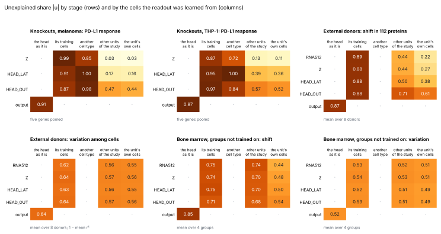

# Two finished pieces of work re-read with the version 2 tool — 16 November 2026

Exploratory. The design and the three criteria are in [`DESIGN.md`](DESIGN.md), committed before any script here was run on data. No model was trained and nothing new was audited: the cells, the head and the measurements are those of earlier runs. The tool is `anm_diag scope` with the hypotheses and tests of [`LOOP_PROTOCOL.md`](../../LOOP_PROTOCOL.md), version 2.

Each cell is |*u*|: the share of a response that a prediction leaves unexplained (0: all of it is carried; 1: none). Rows are stages of the chain; `output` is the head's own prediction. Columns are the cells the readout was learned from.

## The three criteria

| | criterion | result |
|---|---|---|
| G1 | one code and one file format for a perturbation and for a contrast nobody assigned | holds: six SPEC files (donor, perturbation) through one command; none of the functions that compute uses the kind of event |
| G2 | what is already known comes back | holds: knockouts holds; external donors holds |
| G3 | the grid agrees with interventions already made | **in part**. The rule of the design is met in both cell types (test confirmed, confirmed). The reading of the grid: melanoma reads 'coverage', thp1 reads 'unresolved'; where it is unresolved, the gap between the scopes is resolved and says coverage. The forecast intervals did not hold up: 1 of 8 measured values fell inside (see below) |

## What the re-reading says about the tool

- **The scope of version 1 gives back version 1.** A different estimator on the same cells puts the loss at the same stage with almost the same numbers (first table below).
- **The new axis says something version 1 could not, and it agrees with what the repairs showed.** A readout learned from the head's training cells reads almost none of the PD-L1 response from the state; one learned from the other cell type reads little; one learned from the other genes of the same cell type reads it. The repairs that worked were the ones fitted on cells of the same cell type, and the one fitted on the other cell type did not transfer.
- **A forecast from the grid is a ceiling, not a prediction.** The repairs with cells of this kind delivered 71% and 64% of what the grid said a readout could carry at the head's own output. `scope.forecast` now says so, and a rule has to ask for less than the ceiling.
- **The design's forecast was written for the wrong quantity.** It set |u| at the head's 134 outputs (units scope) against |u| at the state in another scope, which goes negative for an arm that cannot help. A forecast and its test have to be about the same quantity. The added check below uses the head's own output on both sides.
- **The margin of 0.10 does not fit every target.** For a donor's shift over 112 proteins and for the variation among a donor's cells, no scope comes within 0.10, not even the donor's own cells, so every donor event is read `unreadable`. The answer is in the gaps between scopes. A margin has to be declared per target, on its own scale.
- **The same picture for an assigned and an unassigned event.** Between groups (a knockout, an external donor) the state carries more than the head delivers and it takes cells of the same kind to read it. Among the cells of a donor the head's stages lose nothing; what is missing there is coverage alone.

## Knockouts: the scope of version 1 gives back version 1

Pooled event, PD-L1, `units` scope (a readout that never saw the gene it is scored on). The sealed values of version 1 are beside the new ones.

| cell type | stage | version 2, `units` | version 1, sealed |
|---|---|---|---|
| melanoma | Z | 0.03 [−0.04, 0.10] support | 0.04 [−0.01, 0.09] support |
| melanoma | HEAD_LAT | 0.17 [0.11, 0.23] reject | 0.20 [0.13, 0.26] reject |
| melanoma | HEAD_OUT | 0.47 [0.43, 0.52] reject | 0.46 [0.41, 0.50] reject |
| thp1 | Z | 0.13 [0.02, 0.31] unresolved | 0.15 [0.04, 0.32] unresolved |
| thp1 | HEAD_LAT | 0.39 [0.27, 0.51] reject | 0.35 [0.30, 0.45] reject |
| thp1 | HEAD_OUT | 0.57 [0.46, 0.68] reject | 0.47 [0.43, 0.58] reject |

- melanoma: the head adds 0.44 [0.38, 0.48] from `Z` to `HEAD_OUT` (interval above 0.10: holds); `HEAD_OUT` rejected: holds; `Z` not rejected: holds. Treated side resampled by 5 clusters, so the intervals are approximate.
- thp1: the head adds 0.43 [0.35, 0.49] from `Z` to `HEAD_OUT` (interval above 0.10: holds); `HEAD_OUT` rejected: holds; `Z` not rejected: holds. Treated side resampled by 5 clusters, so the intervals are approximate.

## Knockouts: what is missing

The scopes at `Z`, the stage the head reads, and the head's own PD-L1 output:

| cell type | the head as it is | readout of its training cells | of the other cell type | of the other genes | with the gene's own cells | reading |
|---|---|---|---|---|---|---|
| melanoma | 0.91 [0.90, 0.93] reject | 0.99 [0.98, 1.00] reject | 0.85 [0.82, 0.88] reject | 0.03 [−0.04, 0.10] support | 0.03 [−0.05, 0.09] support | **coverage**; resolved gaps: train->units, other->units |
| thp1 | 0.97 [0.96, 0.98] reject | 0.87 [0.84, 0.91] reject | 0.72 [0.64, 0.79] reject | 0.13 [0.02, 0.31] unresolved | 0.11 [0.02, 0.20] unresolved | **unresolved**; resolved gaps: train->units, other->units |

- melanoma, gene by gene (5 events): mean |u| at `Z` is 1.00 for a readout of the training cells, 0.93 for the other cell type, 0.06 for the other genes, 0.06 with the gene's own cells. The gap from training cells to other genes is resolved in 5 of 5. Read as: unresolved 5.
- THP-1, gene by gene (5 events): mean |u| at `Z` is 0.90 for a readout of the training cells, 0.71 for the other cell type, 0.22 for the other genes, 0.16 with the gene's own cells. The gap from training cells to other genes is resolved in 4 of 5. Read as: unresolved 4, unreadable 1.

## Knockouts: the grid against the repairs already made

A hypothesis was written from each grid and read against the recorded audits of the repaired heads. It is retrospective: the outcomes were known. The rule was fixed in the design: a fall above 0.20 for the repair with cells of this kind, below 0.20 for the repair with the other cell type.

**As designed**: the fall of |u| at `HEAD_OUT` in the audit of the changed head (version 1 statistic).

| cell type | arm | forecast from the grid | measured | inside the forecast | test |
|---|---|---|---|---|---|
| melanoma | coverage | 0.44 [0.38, 0.48] | 0.33 [0.29, 0.38] | no | confirmed |
| melanoma | other study | −0.37 [−0.42, −0.33] | 0.03 [−0.02, 0.10] | no |  |
| melanoma | function | −0.52 [−0.56, −0.47] | no head was retrained on bone marrow alone | — |  |
| thp1 | coverage | 0.43 [0.35, 0.49] | 0.38 [0.29, 0.46] | yes | confirmed |
| thp1 | other study | −0.16 [−0.23, −0.08] | 0.07 [−0.02, 0.11] | no |  |
| thp1 | function | −0.31 [−0.40, −0.22] | no head was retrained on bone marrow alone | — |  |

The forecast for an arm that cannot help comes out negative: the design subtracted quantities of two different scopes.

**Added after the design** ([`scripts/frozen_arms.py`](scripts/frozen_arms.py)): the same hypothesis on the head's own PD-L1 output, the quantity `scope.forecast` is about, measured from the saved outputs of the repaired heads.

| cell type | the head's own output as trained | arm | ceiling from the grid | measured fall | test |
|---|---|---|---|---|---|
| melanoma | 0.92 | coverage | 0.88 [0.81, 0.92] | 0.62 [0.57, 0.69] | confirmed |
| melanoma | 0.92 | other study | 0.06 [0.03, 0.10] | −0.04 [−0.07, −0.02] |  |
| melanoma | 0.92 | function | −0.08 [−0.10, −0.06] | no head was retrained on bone marrow alone |  |
| thp1 | 0.97 | coverage | 0.84 [0.66, 0.94] | 0.54 [0.46, 0.61] | confirmed |
| thp1 | 0.97 | other study | 0.25 [0.18, 0.33] | 0.13 [0.10, 0.16] |  |
| thp1 | 0.97 | function | 0.10 [0.06, 0.12] | no head was retrained on bone marrow alone |  |

The repair made elsewhere in the head (its decoder, same cells) lowered the head's own output's |u| by 0.37 (melanoma) and 0.33 (thp1). Version 1 found that it removed little of the loss at the head's 134 outputs. The two are different questions: whether the head's answer is right, and whether the information is in its outputs.

Forecast record over both tables: 1 of 8 measured values inside their interval; mean absolute error 0.19. Every miss is on the side of the forecast being too high.

## Donors: the same tool on a contrast nobody assigned

External PBMC, 8 donors, variation among a donor's cells (the head's ordinary score), at `Z`. Criteria of the design: the gap from the head to a readout of its training cells is smaller than the gap from there to the other donors (8 of 8); that gap is positive (8 of 8); the gap from the other donors to the donor's own cells is smaller (8 of 8).

| donor | head → its training cells | training cells → other donors | other donors → own cells |
|---|---|---|---|
| P1 | 0.000 | 0.072 | 0.008 |
| P2 | 0.003 | 0.063 | 0.006 |
| P3 | 0.002 | 0.072 | 0.006 |
| P4 | −0.001 | 0.065 | 0.007 |
| P5 | −0.009 | 0.102 | 0.014 |
| P6 | 0.001 | 0.070 | 0.012 |
| P7 | −0.003 | 0.093 | 0.017 |
| P8 | −0.006 | 0.073 | 0.007 |

Over the 8 donors (intervals from resampling donors, approximate): head → training cells −0.001 [−0.004, 0.001]; training cells → other donors 0.076 [0.068, 0.086]; other donors → own cells 0.010 [0.007, 0.013]. These are differences of *u* = 1 − mean *r*², not of the correlations reported in `runs/generalization_20261112`; the order is the same. None reaches the step margin of 0.10, and no scope reads the variation to within 0.10 (the donor's own cells leave 0.56).

Bone marrow, 12 donor × site groups, the same three comparisons: 12, 7 and 2 of 12. There the head was trained on the study, the other donors add little, and a group's own cells add more than the other donors do.

A donor's shift in protein level (112 proteins), external donors, mean |u|:

| stage | the head as it is | readout of its training cells | of the other donors | with the donor's own cells |
|---|---|---|---|---|
| RNA512 |  | 0.89 | 0.44 | 0.22 |
| Z |  | 0.88 | 0.44 | 0.27 |
| HEAD_LAT |  | 0.88 | 0.50 | 0.38 |
| HEAD_OUT | 0.87 | 0.88 | 0.71 | 0.61 |

Read by the other donors, a donor's shift is carried less at the head's outputs than at the state: |u| rises by 0.27 (0.20 to 0.38) from `Z` to `HEAD_OUT`, resolved in 1 of 8 and unresolved in 7. The variation among a donor's cells is not: 8 of 8 add no loss. This was not a criterion; it is reported.

## The correction to `runs/generalization_20261112`

That run reported how much of a donor's shift in protein level is left unexplained, as a share of squared differences and, for the external donors, without a slope between the head's scale and the measurement's. On the scale of *u* (the square root of the old values) and with the slope (version 2):

| donor | the head: old | version 2 | state, other donors: old | version 2 | state, training cells: old | version 2 | state, own cells: version 2 |
|---|---|---|---|---|---|---|---|
| P1 | 0.91 | 0.90 [0.86, 0.93] | 0.29 | 0.30 [0.30, 0.65] | 1.03 | 0.91 [0.86, 0.96] | 0.20 [0.19, 0.47] |
| P2 | 0.80 | 0.78 [0.70, 0.84] | 0.35 | 0.40 [0.37, 0.59] | 0.93 | 0.79 [0.70, 0.85] | 0.27 [0.24, 0.43] |
| P3 | 0.89 | 0.93 [0.90, 0.96] | 0.46 | 0.50 [0.45, 0.74] | 1.01 | 0.95 [0.90, 0.99] | 0.34 [0.29, 0.55] |
| P4 | 0.87 | 0.89 [0.85, 0.93] | 0.37 | 0.41 [0.39, 0.65] | 0.93 | 0.89 [0.85, 0.92] | 0.28 [0.25, 0.50] |
| P5 | 0.85 | 0.83 [0.78, 0.88] | 0.43 | 0.45 [0.41, 0.77] | 0.91 | 0.84 [0.79, 0.89] | 0.20 [0.20, 0.35] |
| P6 | 0.91 | 0.89 [0.84, 0.92] | 0.52 | 0.49 [0.46, 0.74] | 0.96 | 0.88 [0.82, 0.92] | 0.32 [0.30, 0.47] |
| P7 | 0.93 | 0.87 [0.83, 0.91] | 0.50 | 0.48 [0.44, 0.74] | 1.02 | 0.87 [0.84, 0.93] | 0.24 [0.23, 0.40] |
| P8 | 0.85 | 0.85 [0.74, 0.91] | 0.54 | 0.52 [0.48, 0.68] | 1.00 | 0.94 [0.86, 0.97] | 0.32 [0.30, 0.39] |

- The slope changes little: the head leaves 0.78 to 0.93 of a donor's shift unexplained (old, on this scale: 0.80 to 0.93).
- The scale changes the sentence. The old run said the state, read by the other donors, leaves "8% to 29%" and is below the margin in 1 of 8. On the scale the margin is defined for it leaves 0.30 to 0.52, below the margin in 0 of 8. With the donor's own cells it leaves 0.20 to 0.34.
- What stands: the state carries much more of a donor's shift than the head delivers, and it takes cells of the same study to read it. What does not stand: that the shift "is in the state". About half of it is, by these readouts.
- The conclusions of that run that rest on correlation within a donor are not affected.

## An open hypothesis for the donors

Written from the external-donor grid, not retrospective, not tested: **coverage**. Ceiling for the fall of *u* (variation) at the head's own output on donors it was not trained on: 0.075 [0.068, 0.082] if PBMC cells of other donors are added to its training; −0.001 [−0.004, 0.001] for another map on the same bone-marrow cells. Rule, fixed in the design: confirmed if the first lies above 0.034 and the other two arms below it. If the repairs of the knockout loop are a guide, about two thirds of the ceiling is what to expect.

## The ledger

[`results/ledger.jsonl`](results/ledger.jsonl): 725 typed events (5 hypothesis, 40 source, 4 test, 676 verdict). Opposite verdicts at the same readout, stage, scope and target: 2, all between different events or studies; contradictions: 0. Ledger rules: H2 (warning); H5 (note): the four tests are marked retrospective, and the donor hypothesis is open.

## Limits

- A re-reading of finished work. The hypotheses for the knockouts were written after their outcomes were known; agreement is a check of consistency, not a confirmation.
- In the table as designed, the measured falls use version 1's estimator and the forecasts version 2's.
- The `other study` arm's interval in that table takes its baseline at a point value.
- Five genes of one pathway (intervals over five clusters are approximate); eight external donors of one study, all healthy; one head, one training seed.
- A donor contrast is confounded with site, sample and run in bone marrow.
- Readouts are ridge regressions, and boosting for the pooled knockout events. Donor fits use at most 30,000 cells.
- The first launch of the runs was stopped before it wrote anything, to add the stage-to-stage loss to the output; a second stopped at a programming error in the summary of a family, before writing. Neither had been read.

## Files

- [`DESIGN.md`](DESIGN.md); [`scripts/build.py`](scripts/build.py) (arrays and SPEC files), [`scripts/run.py`](scripts/run.py) (the six runs), [`scripts/frozen_arms.py`](scripts/frozen_arms.py) (added), [`scripts/read.py`](scripts/read.py) (criteria, hypotheses, ledger), [`scripts/write_readme.py`](scripts/write_readme.py)
- `results/<name>/`: `SPEC.yaml`, `scope.json`, `scope_events.jsonl` for each of the six runs (the resamples are not committed)
- [`results/summary.json`](results/summary.json), [`results/ledger.jsonl`](results/ledger.jsonl), [`results/frozen_arms.json`](results/frozen_arms.json)
